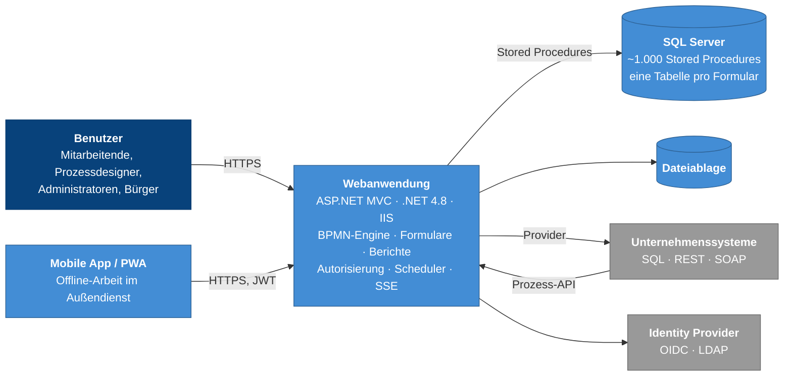

# Architekturnotizen zu GraphBPMS

[](https://github.com/AhadPorkar/bpms-architecture-notes/actions/workflows/ci.yml)
[](LICENSE)
[](LICENSE-CODE)

[English](README.md) · **Deutsch**

Wie eine Enterprise-Low-Code-BPM-Plattform aufgebaut ist – und warum. Dieses Repository enthält C4-Diagramme, elf
Architekturentscheidungen (ADRs), die Methodik hinter einem Spike-Test mit 5.000 Benutzern und die Lehren aus einer
nationalen Sicherheitsevaluierung. Ich habe es in eigenen Worten geschrieben, als derjenige, der das
Plattform-Engineering-Team hinter [GraphBPMS](docs/de/01-overview.md) geleitet hat.

GraphBPMS führt Prozesse nach BPMN 2.0 aus und stellt dynamische Formulare, Berichte und Dashboards bereit – für große
Organisationen des öffentlichen Sektors und der Infrastruktur, auf deren eigenen Servern, auf Persisch und mit dem
Jalali-Kalender (persischer Sonnenkalender).



## Einstieg

| Dokument | Inhalt | Lesezeit |
| --- | --- | --- |
| [1. Überblick](docs/de/01-overview.md) | Zweck, Qualitätsziele, Randbedingungen, Lösungsstrategie, Technologie-Stack | 5 Min. |
| [2. C4-Modell](docs/de/02-c4-model.md) | Systemkontext, Container, Komponenten, Verteilung (Deployment), eine dynamische Sicht | 8 Min. |
| [3. Prozess-Engine](docs/de/03-process-engine.md) | Versionen, Instanzen, die Durchlaufschleife, Gateways, Timer, Nachrichten, Sandbox, Audit | 12 Min. |
| [ADRs](docs/de/adr/README.md) | Elf Entscheidungen, jeweils mit Kontext, Alternativen, Konsequenzen und einer Bewertung im Rückblick | je 3–5 Min. |
| [4. Lasttests](docs/de/04-load-testing.md) | Wie aus 5.000 gleichzeitigen Benutzern ein aussagekräftiger Test wurde | 12 Min. |
| [5. Sicherheitslehren](docs/de/05-security-lessons.md) | Achtzehn Lehren und eine Checkliste vor dem Go-live | 10 Min. |
| [6. Rückblick](docs/de/06-retrospective.md) | Was ich beibehalten und was ich ändern würde, und ein Migrationspfad ohne Neuentwicklung | 6 Min. |
| [Glossar](docs/de/glossary.md) | Durchgängig verwendete Begriffe | 2 Min. |

## Zentrale Entscheidungen

| ADR | Entscheidung | In einem Satz |
| --- | --- | --- |
| [0001](docs/de/adr/0001-stored-procedures-as-the-data-access-contract.md) | Stored Procedures als Vertrag für den Datenzugriff | Eine kleine, auditierbare Angriffsfläche für Injection und von DBAs optimierbare Abfragen – um den Preis von ~1.000 zu versionierenden Prozeduren. |
| [0002](docs/de/adr/0002-graph-walking-engine-inside-the-request.md) | Engine, die den Graphen innerhalb des Requests durchläuft | Sofortiges Feedback und keine zusätzliche Infrastruktur; langsame Integrationen blockieren den Klick. |
| [0003](docs/de/adr/0003-pin-running-instances-to-their-version.md) | Laufende Instanzen an ihre Version binden | Eine Veröffentlichung beschädigt nie einen laufenden Fall; Korrekturen erreichen alte Fälle nicht. |
| [0004](docs/de/adr/0004-multi-organization-tenancy-in-one-database.md) | Mandantenfähigkeit mit mehreren Organisationen in einer Datenbank | Eine Installation für einen ganzen Organisationsverbund; die Isolation braucht ein Sicherheitsnetz auf Datenbankebene. |
| [0005](docs/de/adr/0005-rbac-down-to-record-level.md) | RBAC bis auf Datensatzebene | Modul → Seite → Operation → Datensatz, Verbot hat Vorrang, in vier Schichten durchgesetzt. |
| [0006](docs/de/adr/0006-durable-clustered-timers.md) | Dauerhafte, clusterfähige Timer | Quartz.NET in derselben Datenbank, mit Jalali-fähigen Zeitplänen. |
| [0007](docs/de/adr/0007-dynamic-forms-as-physical-tables.md) | Eine physische Tabelle pro Formular | Einfaches SQL für Berichte und BI, im Gegenzug DDL zur Laufzeit. |
| [0008](docs/de/adr/0008-providers-as-the-single-integration-abstraction.md) | Provider als einzige Integrationsabstraktion | Ein Konnektor für Formulare, Prozesse und Berichte, mit verborgenen Parameterquellen. |
| [0009](docs/de/adr/0009-server-sent-events-first-web-push-as-fallback.md) | SSE zuerst, Web Push als Fallback | Funktioniert durch jeden Proxy; hat SignalR abgelöst. |
| [0010](docs/de/adr/0010-denormalized-inbox-read-model.md) | Denormalisiertes Lesemodell für den Posteingang | Gleichbleibende Latenz auf der meistgenutzten Seite, dafür Schreibverstärkung (Write Amplification). |
| [0011](docs/de/adr/0011-test-sandbox-inside-the-production-engine.md) | Test-Sandbox innerhalb der Produktion | Prozessdesigner testen unter realen Bedingungen; die Isolation muss zentral durchgesetzt werden. |

## Die Plattform auf einen Blick

| | |
| --- | --- |
| Funktionsmodule | 30 |
| Kerntabellen / Fremdschlüssel | 168 / 222, plus eine generierte Tabelle pro Formular |
| Stored Procedures | etwa 1.000 (etwa 400 für die Prozess-Engine) |
| MVC-Controller | etwa 80 |
| Abnahmeziele | p95 < 2 s · ≥ 500 TPS · < 1 % Fehler |
| Spike-Test | bis zu 5.000 gleichzeitige Benutzer |
| Sicherheit | Nationale Sicherheitsevaluierung von IT-Produkten (AFTA), Stufe 1; OWASP ZAP vor jedem Go-live |

## Lasttest-Kit

Der Ordner [`load-testing/`](load-testing/) enthält k6-Skripte mit sieben Profilen (Smoke, Last, Stress, Spike,
Dauertest/Soak, Login-Sturm, Durchsatz), Metriken für Geschäftstransaktionen, einen verteilten Runner und eine Mock-API
ohne externe Abhängigkeiten. Sie wurden für dieses Repository von Grund auf neu geschrieben.

```bash
node load-testing/mock-api/server.js &
k6 run -e PROFILE=smoke -e THINK_MIN_S=0.2 -e THINK_MAX_S=0.5 load-testing/k6/main.js
```

## Aufbau des Repositorys

```text
.
├── docs/
│   ├── en/                 Englisch: Überblick, C4, Engine, ADRs, Lasttests, Sicherheit, Rückblick
│   └── de/                 Deutsche Übersetzung mit derselben Struktur
├── diagrams/structurizr/   das C4-Modell als Code (Structurizr DSL)
├── load-testing/           k6-Skripte, Mock-API, verteilter Runner, Berichtsvorlage
└── .github/workflows/      CI: Markdown-Lint, Linkprüfung, Mermaid-Rendering, Structurizr-Validierung, k6-Smoke-Test
```

## Geltungsbereich und Vertraulichkeit

Diese Notizen beschreiben Architektur und Engineering-Praxis. Sie werden mit Genehmigung des Unternehmens
veröffentlicht und enthalten **keinen Quellcode, kein Datenbankschema, keine Konfiguration, keine Screenshots, keine
Kundennamen und keine Kundendaten** des Produkts. Die Diagramme sind vereinfacht, interne Namen sind durch
beschreibende Begriffe ersetzt, und die Zahlen stammen aus der veröffentlichten technischen Dokumentation des Produkts.
Meinungen, insbesondere in den Abschnitten „Rückblickend“, sind meine eigenen.

## Über den Autor

**Ahad Porkar**, Senior Software Engineer und Solution Architect. Ich arbeite mit Java, .NET und BPMN/Camunda und habe
das 18-köpfige Plattform-Engineering-Team hinter GraphBPMS geleitet.

[ahadporkar.com](https://ahadporkar.com) · [LinkedIn](https://www.linkedin.com/in/seapr) ·
[GitHub](https://github.com/AhadPorkar) · [porkar.ahad@gmail.com](mailto:porkar.ahad@gmail.com)

## Lizenz

Dokumentation und Diagramme: [CC BY 4.0](LICENSE). Code in `load-testing/` und `.github/`: [MIT](LICENSE-CODE).
