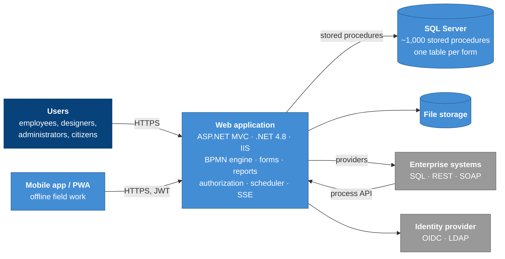

# GraphBPMS architecture notes

[](https://github.com/AhadPorkar/bpms-architecture-notes/actions/workflows/ci.yml)
[](LICENSE)
[](LICENSE-CODE)

**English** · [Deutsch](README.de.md)

How an enterprise low-code BPM platform is built, and why. This repository contains C4 diagrams, eleven architecture
decision records, the method behind a 5,000-user spike test and the lessons from a national security evaluation. I
wrote it in my own words, as the person who led the platform engineering team behind
[GraphBPMS](docs/en/01-overview.md).

GraphBPMS runs BPMN 2.0 processes, dynamic forms, reports and dashboards for large public-sector and infrastructure
organizations, on their own servers, in Persian, with the Jalali calendar.



## Start here

| Document | What you will find | Reading time |
| --- | --- | --- |
| [1. Overview](docs/en/01-overview.md) | Purpose, quality goals, constraints, solution strategy, stack | 5 min |
| [2. C4 model](docs/en/02-c4-model.md) | Context, containers, components, deployment, one dynamic view | 8 min |
| [3. Process engine](docs/en/03-process-engine.md) | Versions, instances, the walk loop, gateways, timers, messages, sandbox, audit | 12 min |
| [ADRs](docs/en/adr/README.md) | Eleven decisions, each with context, alternatives, consequences and hindsight | 3–5 min each |
| [4. Load testing](docs/en/04-load-testing.md) | How 5,000 concurrent users were turned into a meaningful test | 12 min |
| [5. Security lessons](docs/en/05-security-lessons.md) | Eighteen lessons and a pre-go-live checklist | 10 min |
| [6. Retrospective](docs/en/06-retrospective.md) | What I would keep, what I would change, and a migration path without a rewrite | 6 min |
| [Glossary](docs/en/glossary.md) | Terms used throughout | 2 min |

## Key decisions

| ADR | Decision | In one line |
| --- | --- | --- |
| [0001](docs/en/adr/0001-stored-procedures-as-the-data-access-contract.md) | Stored procedures as the data-access contract | A small, auditable injection surface and DBA-tunable queries, at the cost of ~1,000 procedures to version. |
| [0002](docs/en/adr/0002-graph-walking-engine-inside-the-request.md) | Graph-walking engine inside the request | Immediate feedback and no extra infrastructure; slow integrations block the click. |
| [0003](docs/en/adr/0003-pin-running-instances-to-their-version.md) | Pin running instances to their version | Publishing never breaks a running case; fixes do not reach old ones. |
| [0004](docs/en/adr/0004-multi-organization-tenancy-in-one-database.md) | Multi-organization tenancy in one database | One installation for a whole group; isolation needs a database-level safety net. |
| [0005](docs/en/adr/0005-rbac-down-to-record-level.md) | RBAC down to record level | Module → page → operation → record, deny wins, enforced at four layers. |
| [0006](docs/en/adr/0006-durable-clustered-timers.md) | Durable, clustered timers | Quartz.NET in the same database, with Jalali-aware schedules. |
| [0007](docs/en/adr/0007-dynamic-forms-as-physical-tables.md) | One physical table per form | Plain SQL for reports and BI, in exchange for DDL at runtime. |
| [0008](docs/en/adr/0008-providers-as-the-single-integration-abstraction.md) | Providers as the single integration abstraction | One connector for forms, processes and reports, with hidden parameter sources. |
| [0009](docs/en/adr/0009-server-sent-events-first-web-push-as-fallback.md) | SSE first, Web Push as fallback | Works through every proxy; replaced SignalR. |
| [0010](docs/en/adr/0010-denormalized-inbox-read-model.md) | Denormalized inbox read model | Flat latency on the hottest page, with write amplification. |
| [0011](docs/en/adr/0011-test-sandbox-inside-the-production-engine.md) | Test sandbox inside production | Designers test against reality; isolation must be enforced centrally. |

## The platform at a glance

| | |
| --- | --- |
| Functional modules | 30 |
| Core tables / foreign keys | 168 / 222, plus one generated table per form |
| Stored procedures | about 1,000 (about 400 for the process engine) |
| MVC controllers | about 80 |
| Acceptance targets | p95 < 2 s · ≥ 500 TPS · < 1 % errors |
| Spike test | up to 5,000 concurrent users |
| Security | National product security evaluation (AFTA), Level 1; OWASP ZAP before every go-live |

## Load-testing kit

The [`load-testing/`](load-testing/) folder contains k6 scripts with seven profiles (smoke, load, stress, spike, soak,
login storm, throughput), business-transaction metrics, a distributed runner and a dependency-free mock API. They
were written from scratch for this repository.

```bash
node load-testing/mock-api/server.js &
k6 run -e PROFILE=smoke -e THINK_MIN_S=0.2 -e THINK_MAX_S=0.5 load-testing/k6/main.js
```

## Repository layout

```text
.
├── docs/
│   ├── en/                 English: overview, C4, engine, ADRs, load testing, security, retrospective
│   └── de/                 German translation with the same structure
├── diagrams/structurizr/   the C4 model as code (Structurizr DSL)
├── load-testing/           k6 scripts, mock API, distributed runner, report template
└── .github/workflows/      CI: Markdown lint, link check, Mermaid render, Structurizr validate, k6 smoke test
```

## Scope and confidentiality

These notes describe architecture and engineering practice. They are published with the company's permission and
contain **no source code, database schema, configuration, screenshots, customer names or customer data** of the
product. Diagrams are simplified, internal names are replaced by descriptive terms, and figures come from the
product's published technical documentation. Opinions, especially in the "in hindsight" sections, are my own.

## About the author

**Ahad Porkar**, senior software engineer and solution architect. I work with Java, .NET and BPMN/Camunda, and I led
the 18-person platform engineering team behind GraphBPMS.

[ahadporkar.com](https://ahadporkar.com) · [LinkedIn](https://www.linkedin.com/in/seapr) ·
[GitHub](https://github.com/AhadPorkar) · [porkar.ahad@gmail.com](mailto:porkar.ahad@gmail.com)

## License

Documentation and diagrams: [CC BY 4.0](LICENSE). Code in `load-testing/` and `.github/`: [MIT](LICENSE-CODE).
