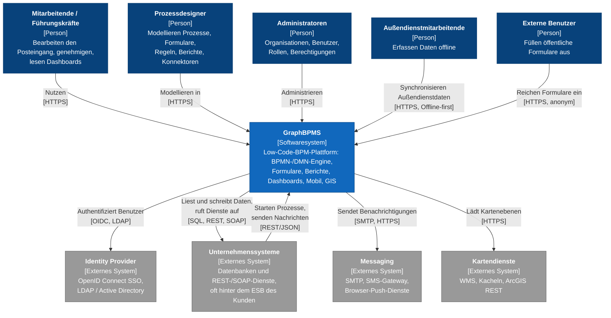
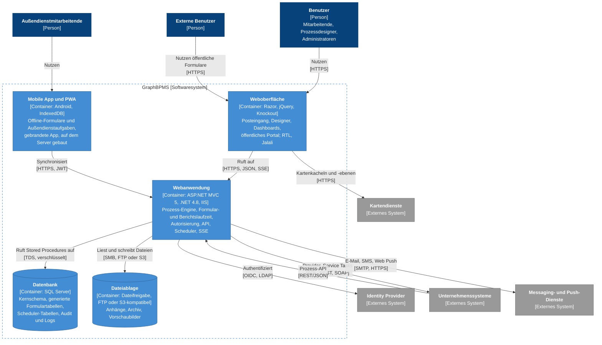
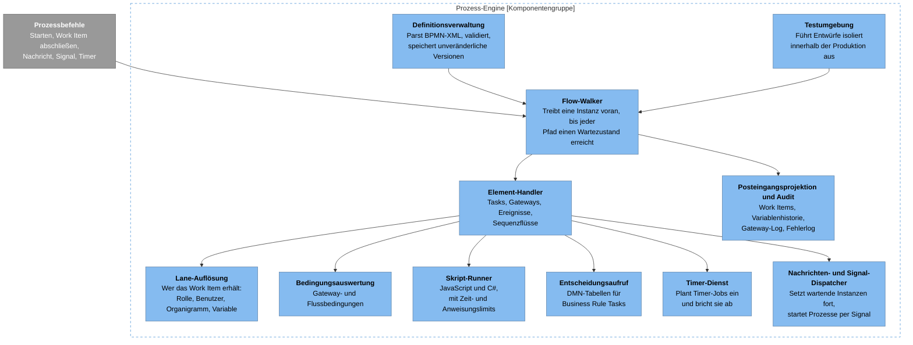
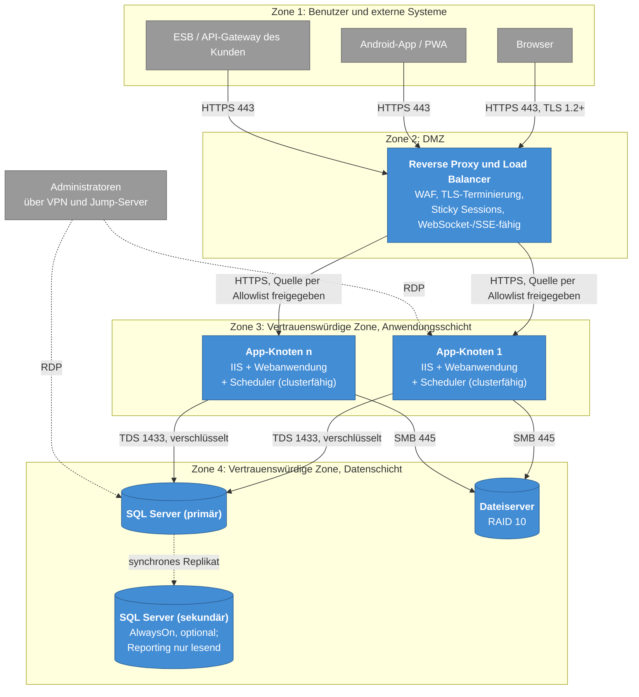
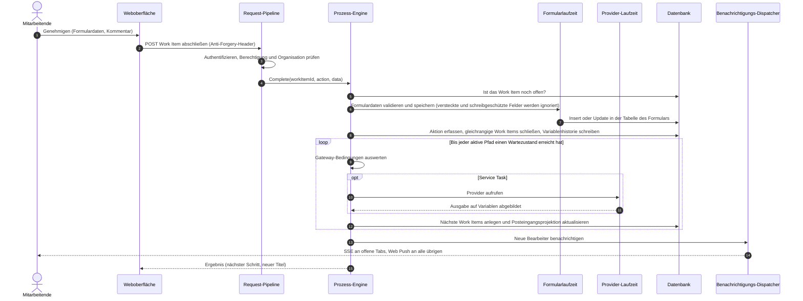

# 2. C4-Modell

[Startseite](../../README.de.md) · [Überblick](01-overview.md) · **C4-Modell** · [Prozess-Engine](03-process-engine.md) · [ADRs](adr/README.md) · [Lasttests](04-load-testing.md) · [Sicherheitslehren](05-security-lessons.md) · [Rückblick](06-retrospective.md) · [Glossar](glossary.md) · [English](../en/02-c4-model.md)

Die Diagramme folgen dem [C4-Modell](https://c4model.com): Systemkontext, Container, Komponenten, dazu eine
Verteilungssicht (Deployment) und eine dynamische Sicht. Sie sind in Mermaid gezeichnet, damit GitHub sie direkt im
Text darstellt. Dasselbe Modell wird als Code in
[`diagrams/structurizr/workspace.dsl`](../../diagrams/structurizr/workspace.dsl) gepflegt – für alle, die Structurizr
bevorzugen.

Farblegende: Dunkelblau = Person, Blau = das System oder seine Container, Hellblau = Komponenten, Grau = extern.

## Ebene 1: Systemkontext

**Lesehilfe.** Die Plattform ist die Drehscheibe zwischen Menschen und den bestehenden Systemen des Kunden. Sie ruft
diese Systeme auf und wird von ihnen aufgerufen. Die zweite Richtung ist wichtig: Andere Systeme starten Prozesse und
senden Nachrichten an wartende Instanzen, sodass die Engine auch als Integrationsendpunkt dient.

## Ebene 2: Container

**Lesehilfe.** Die Plattform ist bewusst ein modularer Monolith. Alles mit Geschäftslogik liegt in einer einzigen
auslieferbaren Webanwendung, und die Datenbank ist der Integrationspunkt zwischen ihren Modulen. Für
On-Premises-Kunden, deren IT eine einzige IIS-Site und einen SQL Server betreibt, war das die richtige Entscheidung, und
es beschränkt Upgrades auf ein einziges Paket. Der Preis: Die Webanwendung beherbergt auch Dinge, die normalerweise
eigene Prozesse wären, etwa den Scheduler und langlebige SSE-Verbindungen. Siehe [den Rückblick](06-retrospective.md).

## Ebene 3: Komponenten der Webanwendung

```mermaid
flowchart TB
    client["<b>Weboberfläche, mobile App, externe Systeme</b>"]

    subgraph app ["Webanwendung [Container]"]
        direction TB
        pipeline["<b>Request-Pipeline</b><br/>[Komponente: OWIN, MVC-Filter]<br/>Cookie- und JWT-Authentifizierung, Anti-Forgery,<br/>Rate Limiting, Bereinigung von Eingaben"]
        controllers["<b>Controller</b><br/>[Komponente: etwa 80 MVC-Controller]<br/>UI-Endpunkte, Prozess-API, Service-Bus-Endpunkte,<br/>öffentliche Formulare, mobile Synchronisation, SSE"]
        authz["<b>Autorisierung</b><br/>[Komponente]<br/>Berechtigungsprüfungen vom Modul<br/>bis zum Datensatz, pro Benutzer gecacht"]
        engine["<b>Prozess-Engine</b><br/>[Komponente]<br/>BPMN-Interpreter, Lanes, Timer,<br/>Nachrichten, Signale, Sandbox"]
        forms["<b>Formularlaufzeit</b><br/>[Komponente]<br/>Formulardefinitionen, generierte Tabellen,<br/>Feldregeln, Signatur von Datensätzen"]
        reports["<b>Berichte und Dashboards</b><br/>[Komponente]<br/>Berichtsdesigner, BI-Widgets,<br/>datengesteuerte Alerts, BAM"]
        providers["<b>Provider-Laufzeit</b><br/>[Komponente]<br/>SQL-, REST- und SOAP-Konnektoren<br/>mit geschützten Parametern"]
        identity["<b>Identität und Organisationen</b><br/>[Komponente]<br/>Benutzer, Rollen, Organigramm,<br/>aktive Organisation"]
        notify["<b>Benachrichtigungs-Dispatcher</b><br/>[Komponente]<br/>In-App, SSE, Web Push,<br/>E-Mail, SMS"]
        scheduler["<b>Scheduler</b><br/>[Komponente: Quartz.NET, clusterfähig]<br/>Prozess-Timer, Berichts-Alerts,<br/>Housekeeping"]
        dataaccess["<b>Datenzugriff</b><br/>[Komponente: schlanker Dapper-Wrapper]<br/>Aufrufe von Stored Procedures,<br/>Logging von Abfragen und Laufzeiten"]
    end

    db[("<b>Datenbank</b><br/>[SQL Server]")]
    ext["<b>Unternehmenssysteme</b><br/>[Extern]"]

    client --> pipeline --> controllers
    controllers --> authz
    controllers --> engine
    controllers --> forms
    controllers --> reports
    controllers --> identity
    engine --> forms
    engine --> providers
    engine --> notify
    reports --> providers
    forms --> providers
    scheduler -- "Löst Timer über<br/>die Prozess-API aus" --> controllers
    providers --> ext
    authz --> dataaccess
    engine --> dataaccess
    forms --> dataaccess
    reports --> dataaccess
    identity --> dataaccess
    dataaccess -- "Stored Procedures" --> db
    scheduler -- "Job-Store" --> db

    classDef component fill:#85bbf0,stroke:#5d82a8,color:#000000
    classDef external fill:#999999,stroke:#6b6b6b,color:#ffffff
    class pipeline,controllers,authz,engine,forms,reports,providers,identity,notify,scheduler,dataaccess component
    class client,db,ext external
    style app fill:none,stroke:#438dd5,stroke-dasharray:5 5
```

Requests folgen demselben Weg: Controller, dann ein Anwendungsservice, dann der Datenzugriffs-Wrapper, dann eine
Stored Procedure pro Operation ([ADR-0001](adr/0001-stored-procedures-as-the-data-access-contract.md)). Die wenigen
Codestellen, die SQL generieren müssen (Formulartabellen, generische Filter, Konfigurationsabgleich und Diagnose), tun
dies in dafür vorgesehenen Komponenten.

## Ebene 3: Komponenten der Prozess-Engine

Die Engine ist ausführlich in [Prozess-Engine](03-process-engine.md) beschrieben.

## Verteilung (Deployment)

Jede Zone kommuniziert nur mit ihrer direkten Nachbarzone. Datenbank und Dateiserver sind für Benutzer und externe
Systeme nie erreichbar. Zwei Details prägen das Betriebshandbuch:

- **Sticky Sessions sind erforderlich**, weil der Sitzungszustand im Prozess gehalten wird. Der Scheduler dagegen kann
  gefahrlos auf jedem Knoten laufen: Der clusterfähige Job-Store garantiert, dass ein Timer auf genau einem Knoten
  auslöst.
- **Der Proxy muss langlebige Responses unterstützen** (SSE) und die Client-IP in einem Header weiterreichen, dem die
  Anwendung nur vertraut, wenn er von der Adresse des Proxys selbst kommt.

Mindestdimensionierung der Produktion für die Referenzinstallation: App-Knoten mit 4–8 Kernen und 8–16 GB RAM; die
Datenbank mit 8–16 Kernen, 32–64 GB RAM und NVMe-Speicher; der Dateiserver mit mindestens 2 TB. Die endgültige
Dimensionierung ergibt sich immer aus einem Lasttest mit den eigenen Daten des Kunden ([Lasttests](04-load-testing.md)).

## Dynamische Sicht: ein Work Item abschließen

Was geschieht, wenn Mitarbeitende im Posteingang bei einer Aufgabe auf „Genehmigen“ klicken.

Alles in der Schleife läuft innerhalb des HTTP-Requests der Person, die geklickt hat. Das ist der prägende
Zielkonflikt der Engine: einfach zu betreiben und zu debuggen, mit sofortigem Feedback – aber lange automatische Ketten
und langsame externe Dienste machen genau diesen Klick langsam. [ADR-0002](adr/0002-graph-walking-engine-inside-the-request.md)
erörtert das.
