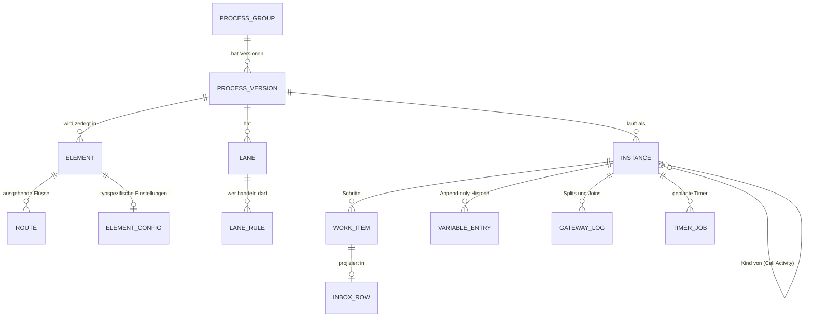
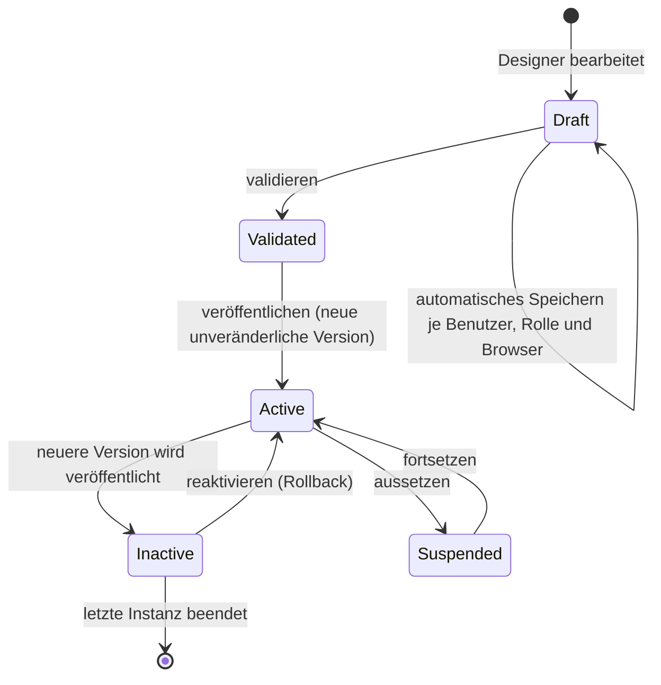
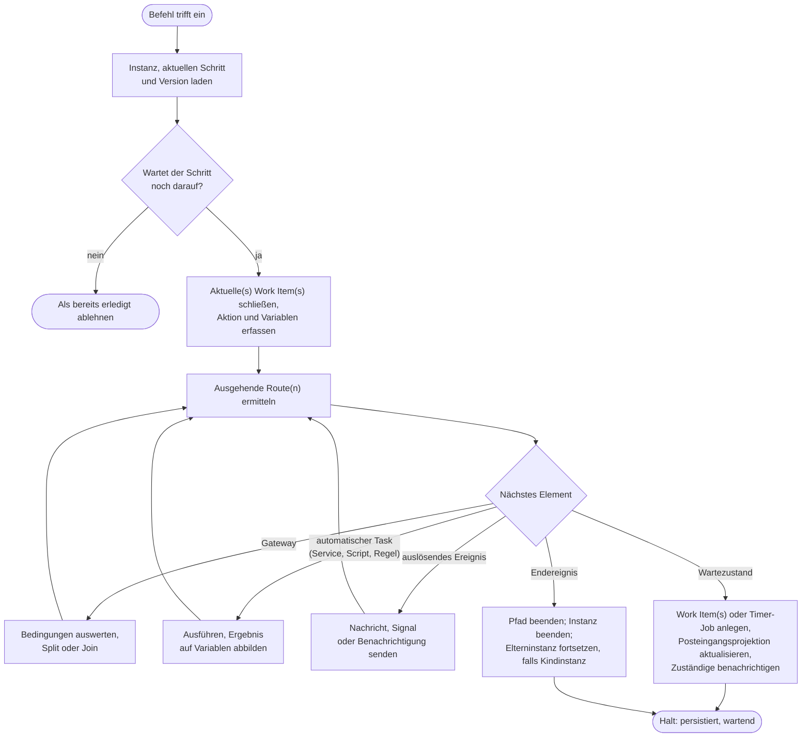

# 3. Die Prozess-Engine

[Startseite](../../README.de.md) · [Überblick](01-overview.md) · [C4-Modell](02-c4-model.md) · **Prozess-Engine** · [ADRs](adr/README.md) · [Lasttests](04-load-testing.md) · [Sicherheitslehren](05-security-lessons.md) · [Rückblick](06-retrospective.md) · [Glossar](glossary.md) · [English](../en/03-process-engine.md)

Die Engine ist das Herzstück der Plattform: rund 46 Tabellen und rund 400 Stored Procedures, mehr als jedes andere
Modul. Diese Seite beschreibt ihre Funktionsweise auf konzeptioneller Ebene. Die zugrunde liegenden Entscheidungen
stehen in den ADRs.

## Begriffe

| Begriff | Bedeutung |
| --- | --- |
| Prozessgruppe | Die stabile Identität eines Prozesses: Name, Menüeintrag, Symbol und Berechtigungen. |
| Prozessversion | Ein veröffentlichtes Diagramm einer Gruppe. Nach der Veröffentlichung unveränderlich. |
| Instanz | Eine Ausführung einer Version, zum Beispiel ein bestimmter Urlaubsantrag. |
| Work Item | Ein in einer Instanz ausgeführter Schritt für einen Empfänger, mit Absender, Empfänger, Aktion und Zeitstempeln. |
| Posteingang | Die Liste der offenen Work Items eines Benutzers für seine aktive Rolle und Organisation. |
| Wartezustand | Ein Element, an dem die Engine anhält und den Zustand persistiert: User Task, Receive Task, empfangendes Ereignis (Catching Event), Timer oder Call Activity. |
| Lane | Die BPMN-Lane, anhand derer entschieden wird, wer ein Work Item erhält. |
| Aktion | Eine Entscheidungsschaltfläche an einem User Task (genehmigen, ablehnen, zurückgeben …), die an einen ausgehenden Sequenzfluss gebunden ist. |

## Konzeptionelles Datenmodell

Die folgenden Namen sind konzeptionell. Es sind nicht die tatsächlichen Tabellennamen.

Drei Eigenschaften dieses Modells sind für alles Weitere entscheidend:

1. **Eine Instanz verweist auf eine Version, nicht auf eine Gruppe.** Jede Navigation filtert nach dieser Version,
   sodass ein laufender Fall immer dem Diagramm folgt, mit dem er gestartet wurde
   ([ADR-0003](adr/0003-pin-running-instances-to-their-version.md)).
2. **Variablen werden nur fortgeschrieben (append-only).** Der aktuelle Wert ist der jüngste Eintrag. Die Historie
   wird nie überschrieben, sodass sich jede Variable „zum Stand“ eines früheren Zeitpunkts im Fall lesen lässt. Nach
   Abschluss einer Instanz werden ihre Einträge in eine Archivtabelle verschoben, damit die stark frequentierte
   Tabelle klein bleibt.
3. **Der Posteingang ist eine Projektion.** Die Posteingangsseite liest eine denormalisierte Tabelle, die die Engine
   in derselben lokalen Transaktion wie das Work Item pflegt ([ADR-0010](adr/0010-denormalized-inbox-read-model.md)).

## Lebenszyklus einer Prozessdefinition

- **Entwurf (Draft).** Das Diagramm des Prozessdesigners wird je Benutzer, Rolle und Browser automatisch
  gespeichert, getrennt von den veröffentlichten Versionen. Eine halbfertige Bearbeitung wirkt sich nie auf das
  Produktivsystem aus.
- **Veröffentlichen.** Die Anwendung parst das BPMN-XML. Das XML wird vollständig gespeichert und zusätzlich in
  relationale Zeilen zerlegt: Elemente, Routen, Lanes, Lane-Regeln und eine Einstellungszeile pro Elementtyp.
  Anschließend laufen die Validierungsregeln über diese Zeilen. Abfragen zur Laufzeit nutzen die Zeilen; das XML ist die Quelle für die Darstellung des Diagramms und
  für die Historie.
- **Genau eine aktive Version pro Gruppe.** Die Veröffentlichung einer ausführbaren Version deaktiviert in derselben
  Transaktion alle anderen Versionen der Gruppe. „Inaktiv“ (Inactive) bedeutet nur „keine neuen Starts“; bereits
  laufende Instanzen laufen weiter.
- **Aussetzen** ist ein zweiter, unabhängiger Schalter. Er nimmt die Arbeit einer Version aus dem Posteingang,
  während ein Problem untersucht wird, ohne ihre Daten anzutasten.
- **Start-Timer werden bewusst scharf geschaltet.** Beim Veröffentlichen werden die Start-Timer der alten Version
  pausiert. Der Zeitplan der neuen Version startet erst, wenn ihn jemand in der Prozessliste scharf schaltet; ein neues
  Diagramm startet also nie überraschend Fälle.

## Befehle

Alles, was eine Instanz weiterbewegt, trifft als einer von wenigen Befehlen ein:

| Befehl | Quelle |
| --- | --- |
| Starten | Ein Benutzer über das Menü, ein öffentliches Formular, ein externes System über die API, ein Signal, ein Start-Timer |
| Work Item abschließen | Ein Benutzer im Posteingang oder in der mobilen App oder ein externes System |
| Nachricht zustellen | Ein externes System, das eine wartende Instanz und einen wartenden Schritt adressiert |
| Signal auslösen | Ein Prozess (auslösendes Ereignis) oder ein externes System, per Schlüssel als Broadcast verteilt |
| Timer auslösen | Der Scheduler, über dieselbe API wie alle anderen |
| Administrative Befehle | Eine Instanz auf einen anderen Schritt verschieben, zurücksetzen, verwerfen, mit Begründung abbrechen |

## Wie eine Instanz voranschreitet

Die Engine ist ein Interpreter. Jeder Befehl lädt die Position der Instanz und durchläuft den Graphen vorwärts, bis
jeder aktive Pfad einen Wartezustand oder ein Endereignis erreicht.

Wissenswerte Punkte:

- **Der Durchlauf erfolgt innerhalb des Requests des Befehls**
  ([ADR-0002](adr/0002-graph-walking-engine-inside-the-request.md)). Wer auf „Genehmigen“ klickt, sieht, sobald die
  Seite zurückkommt, bereits das Ergebnis der gesamten automatischen Kette.
- **Jeder Schritt wird einzeln committet.** Es gibt keine Transaktion um den gesamten Durchlauf. Schlägt auf halbem
  Weg etwas fehl, bleibt die Instanz auf dem zuletzt committeten Schritt stehen, der Fehler landet im
  Fehlerprotokoll der Engine, und ein Administrator kann die Instanz über die Monitoring-Masken erneut ausführen,
  verschieben oder zurücksetzen.
- **„Bereits erledigt“ ist eine Prüfung, keine Sperre.** Beim Abschließen eines Work Items wird zuerst geprüft, ob
  es noch offen ist. Das verhindert doppeltes Absenden durch einen Benutzer, aber zwei verschiedene Requests, die um
  denselben Join konkurrieren, werden nicht serialisiert. Das ist das Erste, was ich ändern würde (siehe Rückblick).

## Gateways

| Gateway | Split | Join |
| --- | --- | --- |
| Exklusiv | Die erste Route, deren Bedingung wahr ist, andernfalls die Standardroute. | Wird durchlaufen. |
| Inklusiv | Jede Route, deren Bedingung wahr ist. Schreibt einen Protokolleintrag mit einer neuen Token-ID und der Anzahl der akzeptierten Routen. | Ermittelt den zugehörigen Split und wartet, bis diese Anzahl an Routen eingetroffen ist. |
| Parallel | Alle Routen. Die Zweige werden nacheinander (per Tiefensuche) im selben Request durchlaufen, es gibt also keine echte Nebenläufigkeit innerhalb eines Befehls. | Zählt die Ankünfte und gleicht sie mit der Anzahl der eingehenden Routen ab, und zwar so, dass auch Schleifen verkraftet werden. |

Bedingungen sind Ausdrücke über Prozessvariablen, die ein kleiner Ausdrucksauswerter auswertet. Prozessdesigner
schreiben für eine Bedingung nie Code.

## Wer ein Work Item erhält

Jede Lane trägt eine oder mehrere Regeln. Eine Regel kann Folgendes benennen:

- eine **Rolle**, eine **Rollengruppe** oder einen bestimmten **Benutzer**, optional auf eine Organisation
  beschränkt;
- eine Position im **Organigramm** relativ zur Person, die den vorherigen Schritt bearbeitet hat: deren
  Vorgesetzte, Gleichrangige oder Unterstellte;
- eine **Prozessvariable**, deren Wert zur Laufzeit ein Benutzer, eine Rolle oder ein Benutzer in einer Rolle ist.

Der Schritt, der das Startereignis enthält, wird immer an die Person zurückgeleitet, die den Fall gestartet hat.

Erhalten mehrere Personen denselben Schritt, entscheidet der User Task, wann er abgeschlossen ist:

- **Eine beliebige Person** handelt, und die Items der anderen werden geschlossen.
- **Alle** handeln; der Schritt wartet auf die letzte Person.
- **Erste Person je Rolle.** Die erste Person aus jeder Rolle zählt für diese Rolle. Das ist nützlich für
  Gremienfreigaben.

Weitere Optionen pro Task: Aktionen mit Farben und Symbolen, Pflichtkommentare auf bestimmten Routen, eine
„Zurückgeben“-Route, Kopien zur Kenntnis (keine Aktion erforderlich), Massenaktionen auf vielen Items gleichzeitig,
Speichern des Formulars als Entwurf sowie die Steuerung, wer die Fallhistorie oder das Diagramm sehen darf.

**Vertretung.** Benutzer können ihren Posteingang für eine Prozessgruppe und einen Zeitraum an einen anderen
Benutzer oder eine Rolle delegieren. Wird ein Item in Vertretung bearbeitet, wird die zu diesem Zeitpunkt gültige
Vertretungsregel auf das Work Item kopiert. Die Historie bleibt korrekt, auch nachdem die Regel geändert oder
gelöscht wurde.

## Timer

- **Start-Timer** verwenden einen Cron-Zeitplan, der im Jalali-Kalender (persischer Sonnenkalender) formuliert sein
  kann („am 1. jedes persischen Monats“). Jalali-Zeitpläne werden zu einem weiter gefassten gregorianischen
  Zeitplan expandiert, und der Job prüft beim Auslösen das persische Datum erneut.
- **Zwischen-Timer** warten bis zu einem Datum, das aus einer Prozessvariable stammt, oder eine feste Dauer lang.
- **Angeheftete Timer** (Boundary Timer) an einem Task schließen dessen offene Work Items mit dem Status „durch
  Timer geschlossen“ und setzen den Ablauf entlang der Route des angehefteten Ereignisses fort.

Alle Timer sind dauerhaft und clusterfähig ([ADR-0006](adr/0006-durable-clustered-timers.md)). Ein Timer wird über
eigene Endpunkte der Prozess-API ausgelöst, und zwar als technischer Benutzer. Jede Timer-Ausführung wird daher wie
jeder andere Befehl authentifiziert und protokolliert.

## Nachrichten, Signale und Subprozesse

- **Nachrichten** werden direkt an eine Instanz und den darauf wartenden Schritt adressiert. Ein Nachrichtenereignis
  kann das Konto benennen, das die Nachricht senden darf. Das ist einfacher als die BPMN-Korrelation über einen
  Business Key und reichte aus, weil externe Systeme stets die Instanz-ID erhielten, wenn der Prozess sie zuerst
  aufrief.
- **Signale** werden per Schlüssel als Broadcast verteilt. Ein Signal startet jede *aktive* Prozessversion, deren
  Startereignis auf diesen Schlüssel hört, und setzt jede Instanz fort, die in einem passenden empfangenden Ereignis
  wartet.
- **Call Activities** starten eine Kindinstanz der aktiven Version einer anderen Prozessgruppe, mit Ein- und
  Ausgabe-Mapping. Die Kindinstanz speichert ihre Elterninstanz und den aufrufenden Schritt. Endet die Kindinstanz,
  wird die Elterninstanz fortgesetzt. Eine Ausnahme in der Kindinstanz wird an die Elterninstanz weitergereicht, und
  das Verwerfen einer Elterninstanz wird auf ihre Kindinstanzen kaskadiert.

## Automatische Tasks

| Task | Mechanismus |
| --- | --- |
| Service Tasks, Send Tasks und Receive Tasks | Rufen einen *Provider* auf: einen wiederverwendbaren, parametrisierten Konnektor zu einer SQL-Quelle, einem REST-Dienst oder einem SOAP-Dienst ([ADR-0008](adr/0008-providers-as-the-single-integration-abstraction.md)). Ausgabefelder werden auf Variablen abgebildet. |
| Script Task | JavaScript in einem eingebetteten Interpreter oder zur Laufzeit kompiliertes C#. Beides läuft mit Zeit- und Anweisungslimits und einer Sperrliste (Deny-List) für Namespaces. C#-Skripte lassen sich pro Installation abschalten. |
| Business Rule Task | Wertet eine DMN-Entscheidungstabelle aus. Entscheidungstabellen werden getrennt von Prozessen versioniert, sodass sich eine Regel (zum Beispiel ein Genehmigungslimit) ohne neues Diagramm ändern lässt. |
| Benachrichtigungsereignis | Sendet von jedem Punkt im Diagramm aus eine In-App-Nachricht, E-Mail, SMS oder Push-Nachricht, mit Betreff und Text aus Vorlagen. |

**Angeheftete Fehlerereignisse** (Error Boundary Events) fangen jeden Fehler des Tasks ab, an den sie angeheftet
sind. Sie können die Fehlerdetails in eine Variable schreiben und entlang einer alternativen Route fortfahren, zum
Beispiel zu einem manuellen Task „Daten korrigieren“.

## Testumgebung

Prozessdesigner können ein Diagramm vor der Veröffentlichung ausführen, innerhalb der Produktivinstallation, mit
Breakpoints sowie den Steuerelementen „Weiter“ und „Schritt überspringen“. Die Sandbox ist eine normale Version, die
mit einer Testumgebungs-ID markiert ist. Diese ID wird auf jede Laufzeitzeile kopiert, die die Sandbox erzeugt, und
die Abfragen hinter Posteingängen, Prozesslisten und Monitoring schließen markierte Zeilen aus. Benachrichtigungen
werden im Testmodus unterdrückt. Siehe [ADR-0011](adr/0011-test-sandbox-inside-the-production-engine.md).

## Audit-Trail und Monitoring

Für jede Instanz kann die Plattform Folgendes anzeigen:

- jedes Work Item: Absender, Empfänger, Rolle und Organisation beider, Aktion, Kommentar, Eingangs- und
  Ausgangszeit sowie die Wartezeit;
- die vollständige Historie jeder Variablen, einschließlich der Werte archivierter Instanzen;
- jede Gateway-Entscheidung;
- jeden Engine-Fehler mit dem Schritt, in dem er aufgetreten ist;
- das Diagramm genau der Version, auf der die Instanz lief, mit hervorgehobenem durchlaufenem Pfad.

**BAM (Business Activity Monitoring)** führt mengenbasierte Abfragen über dieselben Tabellen aus: Anzahl der
Instanzen nach Status, Schrittdauern (Minimum, Durchschnitt, Maximum je Schritt und Lane), Ausnahmen nach Typ und
tägliche Zusammenfassungen. Diese Abfragen sind die lastintensivsten Lesezugriffe im System. Sie sind so
geschrieben, dass sie lesen, ohne die schreibenden Zugriffe der Engine zu blockieren, und das Dashboard-Frontend
dedupliziert und cacht Requests aggressiv.

## Bekannte Grenzen

Ich führe sie auf, weil sie die ehrlichen Kompromisse des Designs sind und weil ich sie beim Bau der nächsten Engine
als Erstes angehen würde:

- Lange automatische Ketten und langsame externe Dienste laufen innerhalb des Requests eines Benutzers.
- Parallele Zweige laufen sequenziell, und Joins verlassen sich auf Prüfungen statt auf Sperren.
- Prozesseinstellungen liegen an zwei Orten, im XML und in den relationalen Zeilen. Sie synchron zu halten,
  erfordert Reparaturroutinen.
- Nachrichten werden über die Instanz-ID adressiert, statt über einen Business Key korreliert zu werden.

Der [Rückblick](06-retrospective.md) beschreibt das Zieldesign, das diese Grenzen beseitigt.
