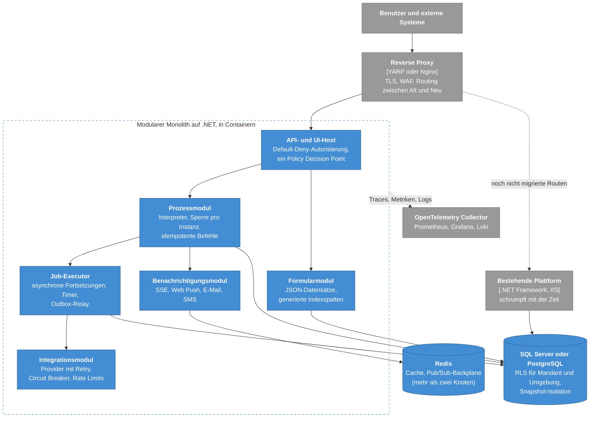

# 6. Rückblick: was ich behalten und was ich ändern würde

[Startseite](../../README.de.md) · [Überblick](01-overview.md) · [C4-Modell](02-c4-model.md) · [Prozess-Engine](03-process-engine.md) · [ADRs](adr/README.md) · [Lasttests](04-load-testing.md) · [Sicherheitslehren](05-security-lessons.md) · **Rückblick** · [Glossar](glossary.md) · [English](../en/06-retrospective.md)

Die meisten Entscheidungen in diesem Repository waren für ihre Zeit und ihren Markt richtig: On-Premises-Kunden,
IT-Abteilungen mit reinem Microsoft-Stack, ein kleines Team und eine nationale Sicherheitsevaluierung. Diese Seite
trennt, was ich behalten würde, von dem, was ich ändern würde, und skizziert einen Migrationspfad, der ohne
Neuentwicklung auskommt.

## Was ich behalten würde

| Idee | Warum sie sich bewährt hat |
| --- | --- |
| Ein einziger, unspektakulärer Request-Pfad (Controller → Service → Stored Procedure) | Leicht abzusichern, Prüfenden leicht zu erklären, leicht zu optimieren. |
| Unveränderliche Prozessversionen, an die Instanzen fest gebunden bleiben | Das Veröffentlichen wurde zum Routinevorgang, und der Audit-Trail ist exakt. |
| Provider als einzige Integrationsabstraktion | Ein Konnektor bedient Formulare, Prozesse und Berichte. Verborgene Parameterquellen haben eine ganze Fehlerklasse beseitigt. |
| Mitgliedschaftsbasierte Mandantenfähigkeit mit mehreren Organisationen | Passt zu Unternehmensgruppen und Ministerien. Organisationsübergreifende Prozesse gibt es ohne Zusatzaufwand. |
| Freigaben auf Datensatzebene, die Fachanwender selbst verwalten | Administratoren sind nicht länger der Engpass. |
| Denormalisiertes Lesemodell für den Posteingang | Gleichbleibende Latenz auf der am stärksten frequentierten Seite. |
| Eine Test-Sandbox innerhalb der Produktivumgebung | Designer testen gegen die Realität. |
| Vollwertige Unterstützung des Jalali-Kalenders (persischer Sonnenkalender), einschließlich Timern | Für den Markt nicht verhandelbar und nachträglich schwer einzubauen. |
| SSE zuerst, Web Push als Fallback | Funktioniert durch jeden Proxy, ohne Client-Bibliotheken. |

## Was ich ändern würde

| Heute | Ziel | Auslöser für die Umsetzung |
| --- | --- | --- |
| Die Engine durchläuft den Graphen synchron innerhalb des Requests; keine Sperre pro Instanz | Sperre pro Instanz, Idempotenzschlüssel, explizite asynchrone Fortsetzungen über eine Job-Tabelle und eine Outbox ([ADR-0002](adr/0002-graph-walking-engine-inside-the-request.md)) | Erster Kunde mit langsamen oder unzuverlässigen externen Systemen in Service Tasks |
| Die Engine hängt vom Kontext des Web-Requests ab; Timer rufen die Anwendung per HTTP-Loopback auf | Engine als einfacher Service; Timer als Tabellenzeilen, die ein In-Process-Job-Executor für sich beansprucht ([ADR-0006](adr/0006-durable-clustered-timers.md)) | Zusammen mit dem Punkt darüber |
| Filter für Mandant und Umgebung per Konvention | `SESSION_CONTEXT` plus Row-Level Security, im Zweifel sperren („fail closed“) ([ADR-0004](adr/0004-multi-organization-tenancy-in-one-database.md), [ADR-0011](adr/0011-test-sandbox-inside-the-production-engine.md)) | Jetzt: Es ist günstig und ein Sicherheitsnetz |
| Dirty Reads für Monitoring und Listen | `READ_COMMITTED_SNAPSHOT` auf Datenbankebene | Jetzt |
| Zwei Auswertungslogiken für Berechtigungen | Ein einziger Policy Decision Point mit tabellengetriebenen Tests ([ADR-0005](adr/0005-rbac-down-to-record-level.md)) | Nächste Änderung am Berechtigungsmodell |
| Rund 1.000 Stored Procedures für alles | Prozeduren für mengenbasierte Hot Paths (stark frequentierte Pfade); einfaches parametrisiertes SQL für CRUD; Migrationen mit DbUp oder Flyway in der CI ([ADR-0001](adr/0001-stored-procedures-as-the-data-access-contract.md)) | Zuerst neue Module; bestehende, sobald sie angefasst werden |
| Physische Tabelle pro Formular, DDL zur Laufzeit | JSON-Spalte plus generierte, indizierte Spalten oder DDL über einen Schema-Service mit minimalen Rechten ([ADR-0007](adr/0007-dynamic-forms-as-physical-tables.md)) | Ein DBA beim Kunden verweigert DDL-Rechte für das Anwendungskonto |
| In-Process-Session, Caches und SSE-Registry | Zustandslose Knoten: Data-Protection-Schlüssel in der Datenbank, verteilter Cache und Pub/Sub-Backplane bei mehr als zwei Knoten | Skalierung über zwei Anwendungsknoten hinaus |
| .NET Framework 4.8 auf Windows und IIS | .NET 8/10 in Linux-Containern, weiterhin On-Premises | Ab sofort jeder neue Service |
| Logs in Datenbanktabellen | OpenTelemetry-Traces, -Metriken und -Logs; Prometheus, Grafana und Loki vor Ort | Das nächste Major Release |

## Zielbild

## Migrationspfad ohne Neuentwicklung

Jeder Schritt lässt sich einzeln ausliefern und zahlt sich bereits für sich genommen aus.

1. **Zuerst Sicherheitsnetze, ohne Schemaänderung.** Eine Anwendungssperre pro Instanz rund um die Engine-Befehle.
   Idempotenzschlüssel in der Prozess-API. `READ_COMMITTED_SNAPSHOT` auf der Datenbank. Tests zur Mandantenisolation
   in der CI.
2. **Row-Level Security** für die Organisation und die Testumgebung, gespeist aus `SESSION_CONTEXT`. Zunächst im
   Audit-Modus betreiben und Verstöße protokollieren, dann durchsetzen.
3. **Asynchrone Fortsetzungen.** Eine Job-Tabelle und ein Executor innerhalb der bestehenden Anwendung. Designer
   können Service Tasks als „asynchron“ markieren. Timer wechseln auf denselben Executor, und der HTTP-Loopback
   entfällt.
4. **Engine ohne Web-Request-Kontext.** Die Engine hinter eine Schnittstelle extrahieren, die von der Webschicht, dem
   Executor und Tests aufgerufen werden kann. Das ist das größte Refactoring, und die vorherigen Schritte machen es
   sicher.
5. **Strangler-Fig-Muster.** YARP davorschalten. Neue Module und neu geschriebene Endpunkte laufen auf .NET 8/10 in
   Containern. Der Proxy leitet sie weiter, die alte Anwendung behält den Rest, und beide teilen sich während der
   Übergangsphase die Datenbank.
6. **Observability.** OpenTelemetry im alten wie im neuen Code, damit sich ein Request über die Grenze hinweg
   verfolgen lässt.

## Make or Buy – neu bewertet

Würde ich heute mit einem Stack beginnen, der es zulässt, würde ich ernsthaft **Camunda 8 oder Flowable als
Ausführungskern** in Betracht ziehen und den eigenen Aufwand dort investieren, wo die Kunden ihn spüren: Formulare,
Routing- und Vertretungsregeln, der persische Kalender, Monitoring, die Low-Code-Designer und der Integrationskatalog.
Der Bau einer eigenen Engine hat dem Team sehr viel beigebracht. Doch der Umgang einer ausgereiften Engine mit
Nebenläufigkeit, Incidents und Migration steckt in jahrelanger Arbeit, für die ein Produktteam selten bezahlt wird.
