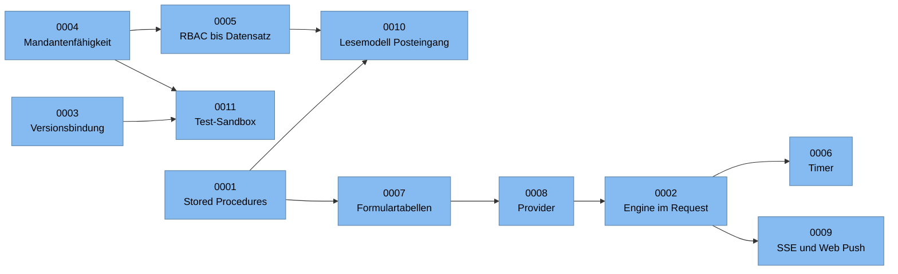

# Architekturentscheidungen (ADRs)

[Startseite](../../../README.de.md) · [Überblick](../01-overview.md) · [C4-Modell](../02-c4-model.md) · [Prozess-Engine](../03-process-engine.md) · **ADRs** · [Lasttests](../04-load-testing.md) · [Sicherheitslehren](../05-security-lessons.md) · [Rückblick](../06-retrospective.md) · [Glossar](../glossary.md) · [English](../../en/adr/README.md)

Ich habe diese Dokumente **im Nachhinein** verfasst. Jedes erläutert eine Entscheidung, die die Plattform in ihrer
heutigen Form prägt. Zu jeder Entscheidung nennt es die treibenden Kräfte, die realistischen Alternativen, was sie
uns gekostet hat und wie ich heute entscheiden würde. Die Abschnitte „Betrachtete Optionen“ führen die Alternativen
auf, die ein vernünftiges Team abwägen würde. Sie sind kein Sitzungsprotokoll.

Das Format ist eine schlanke Variante von [MADR](https://adr.github.io/madr/). Eine leere Vorlage liegt in
[template.md](template.md).

| ADR | Entscheidung | Status |
| --- | --- | --- |
| [0001](0001-stored-procedures-as-the-data-access-contract.md) | Stored Procedures als Vertrag für den Datenzugriff | Angenommen |
| [0002](0002-graph-walking-engine-inside-the-request.md) | Eigener BPMN-Interpreter, der den Graphen innerhalb des Requests durchläuft | Angenommen, mit bekannten Grenzen |
| [0003](0003-pin-running-instances-to-their-version.md) | Laufende Instanzen bleiben auf ihrer Startversion | Angenommen |
| [0004](0004-multi-organization-tenancy-in-one-database.md) | Mandantenfähigkeit mit mehreren Organisationen in einer gemeinsamen Datenbank | Angenommen |
| [0005](0005-rbac-down-to-record-level.md) | Rollenbasierte Zugriffskontrolle bis auf Datensatzebene | Angenommen |
| [0006](0006-durable-clustered-timers.md) | Dauerhafte, clusterfähige Timer mit Jalali-Zeitplänen | Angenommen, ersetzt eine frühere Job-Bibliothek |
| [0007](0007-dynamic-forms-as-physical-tables.md) | Jedes dynamische Formular besitzt eine physische Tabelle | Angenommen |
| [0008](0008-providers-as-the-single-integration-abstraction.md) | Provider als einzige Integrationsabstraktion | Angenommen |
| [0009](0009-server-sent-events-first-web-push-as-fallback.md) | Server-Sent Events zuerst, Web Push als Fallback | Angenommen, ersetzt SignalR |
| [0010](0010-denormalized-inbox-read-model.md) | Ein denormalisiertes Lesemodell für den Posteingang | Angenommen |
| [0011](0011-test-sandbox-inside-the-production-engine.md) | Eine Test-Sandbox innerhalb der produktiven Engine | Angenommen |

## Wie die Entscheidungen zusammenhängen

ADR-0004 und ADR-0011 verbindet eine gemeinsame Lehre: Wenn eine Dimension wie Mandant oder Umgebung in jeder
Abfrage gefiltert werden muss, sollte ein zentraler Mechanismus dies durchsetzen, statt darauf zu vertrauen, dass
jede einzelne Abfrage daran denkt.
