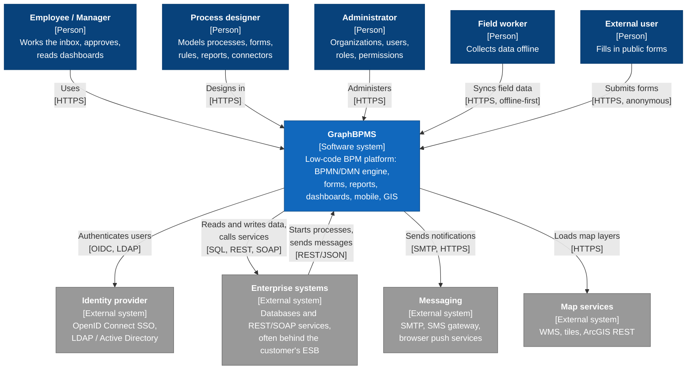
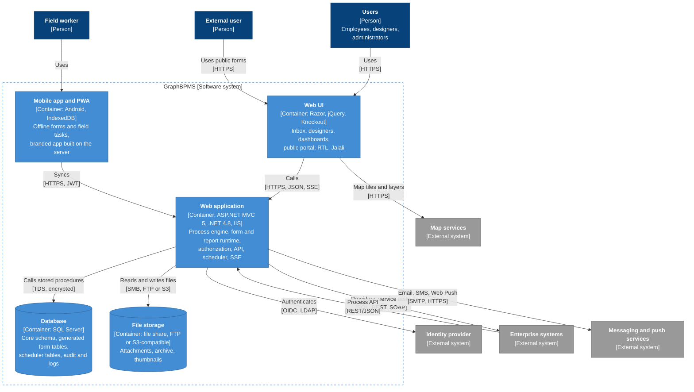
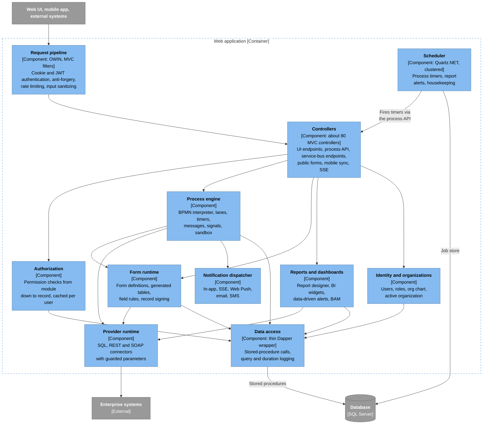
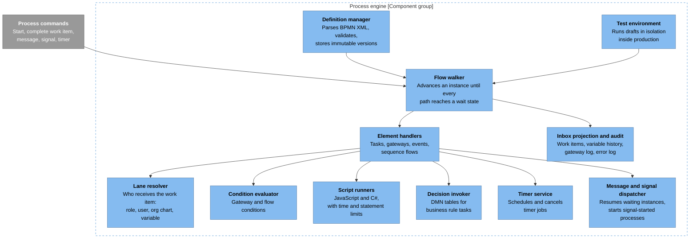
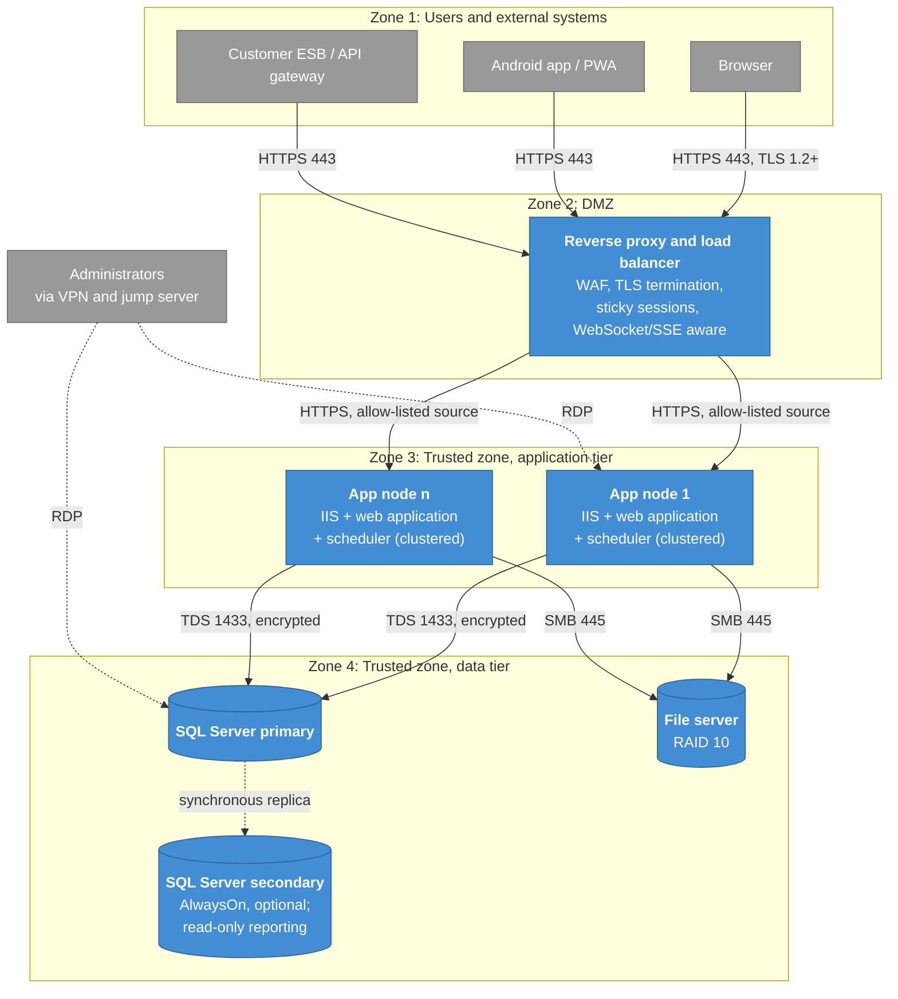
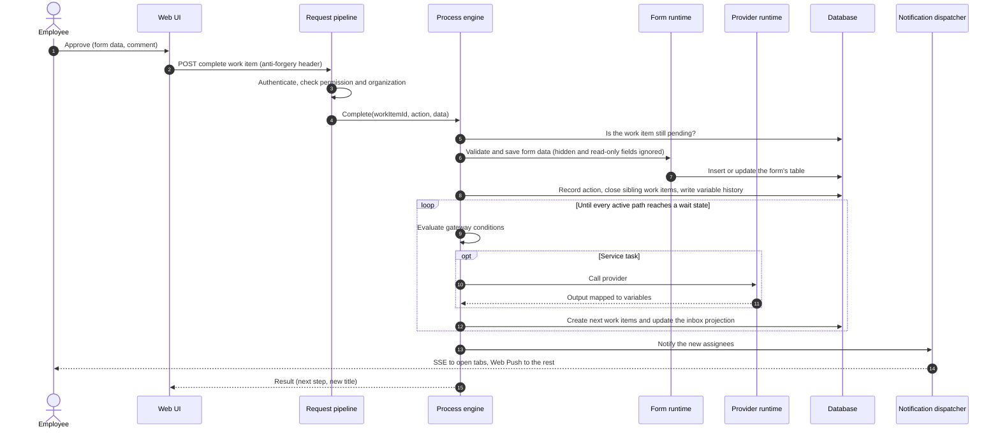

# 2. C4 model

[Home](../../README.md) · [Overview](01-overview.md) · **C4 model** · [Process engine](03-process-engine.md) · [ADRs](adr/README.md) · [Load testing](04-load-testing.md) · [Security lessons](05-security-lessons.md) · [Retrospective](06-retrospective.md) · [Glossary](glossary.md) · [Deutsch](../de/02-c4-model.md)

The diagrams follow the [C4 model](https://c4model.com): context, containers, components, plus a deployment view and one
dynamic view. They are drawn in Mermaid so that GitHub renders them inline. The same model is kept as code in
[`diagrams/structurizr/workspace.dsl`](../../diagrams/structurizr/workspace.dsl) for anyone who prefers Structurizr.

Colour key: dark blue = person, blue = the system or its containers, light blue = components, grey = external.

## Level 1: System context

**Reading it.** The platform is the hub between people and the customer's existing systems. It calls those systems
and is called by them. The second direction matters: other systems start processes and send messages to waiting
instances, so the engine also acts as an integration endpoint.

## Level 2: Containers

**Reading it.** The platform is deliberately a modular monolith. Everything with business logic lives in one
deployable web application, and the database is the integration point between its modules. That was the right
call for on-premises customers whose IT runs one IIS site and one SQL Server, and it keeps upgrades to a single
package. The price is that the web application also hosts things that would normally be separate processes, such as
the scheduler and long-lived SSE connections. See [the retrospective](06-retrospective.md).

## Level 3: Components of the web application

Requests follow the same path: controller, then an application service, then the data-access wrapper, then one
stored procedure per operation ([ADR-0001](adr/0001-stored-procedures-as-the-data-access-contract.md)). The few
places that must generate SQL (form tables, generic filters, configuration sync and diagnostics) do it in dedicated
components.

## Level 3: Components of the process engine

The engine is described in detail in [Process engine](03-process-engine.md).

## Deployment

Each zone talks only to its direct neighbour. The database and the file server are never reachable from users or
external systems. Two details shape the operations guide:

- **Sticky sessions are required** because session state is kept in process. The scheduler, on the other hand, is
  safe on every node: the clustered job store guarantees that a timer fires on exactly one node.
- **The proxy must support long-lived responses** (SSE) and must pass the client IP in a header that the application
  trusts only from the proxy's own address.

Minimum production sizing for the reference deployment: app nodes with 4–8 cores and 8–16 GB RAM; the database with
8–16 cores, 32–64 GB RAM and NVMe storage; the file server with at least 2 TB. Final sizing always comes out of a
load test on the customer's own data ([Load testing](04-load-testing.md)).

## Dynamic view: completing a work item

What happens when an employee presses "Approve" on a task in the inbox.

Everything in the loop runs inside the HTTP request of the person who clicked. This is the defining trade-off of the
engine: simple to operate and to debug, with immediate feedback, but long automatic chains and slow external
services make that click slow. [ADR-0002](adr/0002-graph-walking-engine-inside-the-request.md) discusses it.
