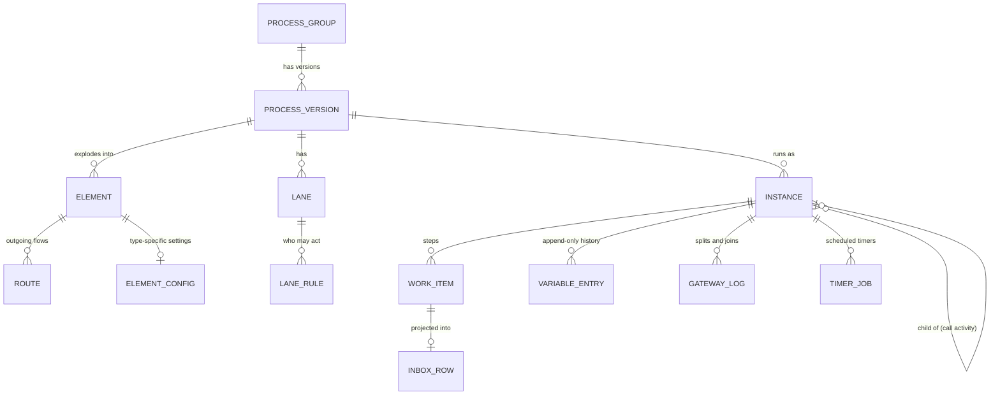
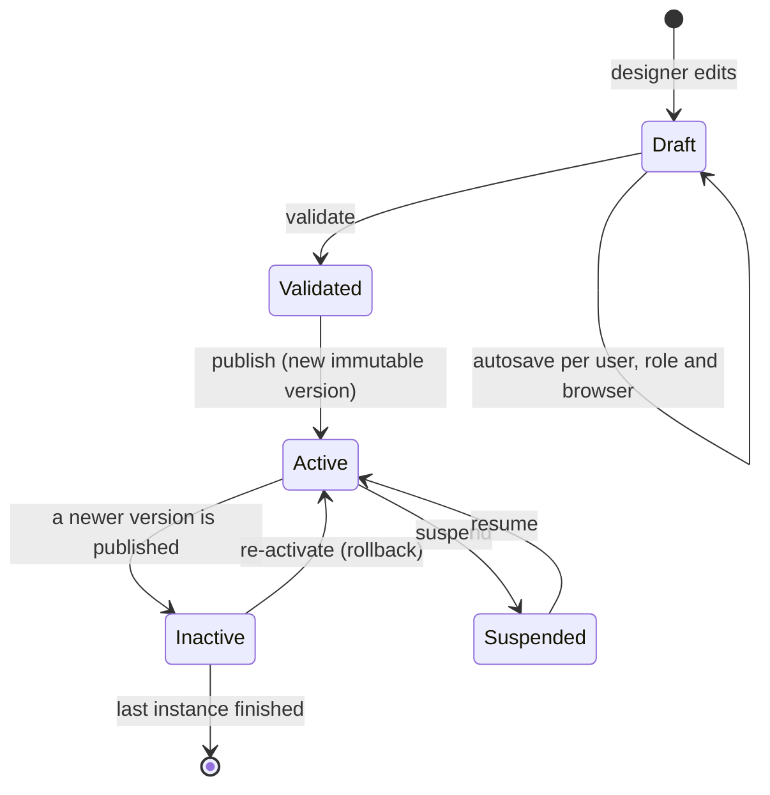
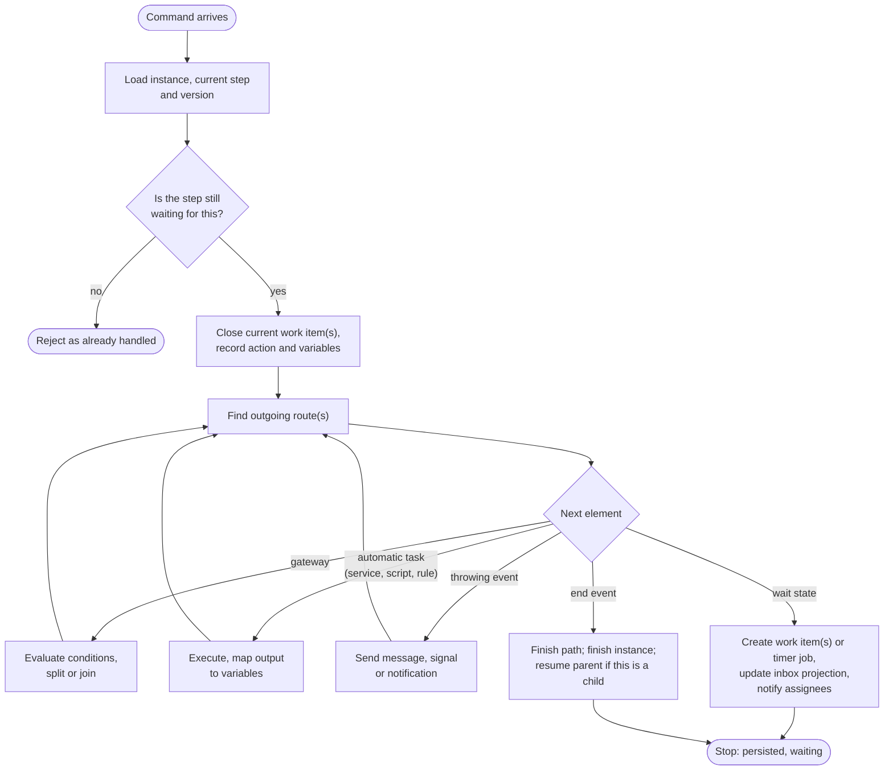

# 3. The process engine

[Home](../../README.md) · [Overview](01-overview.md) · [C4 model](02-c4-model.md) · **Process engine** · [ADRs](adr/README.md) · [Load testing](04-load-testing.md) · [Security lessons](05-security-lessons.md) · [Retrospective](06-retrospective.md) · [Glossary](glossary.md) · [Deutsch](../de/03-process-engine.md)

The engine is the centre of the platform: about 46 tables and about 400 stored procedures, more than any other
module. This page describes how it works at the level of concepts. The decisions behind it are in the ADRs.

## Vocabulary

| Term | Meaning |
| --- | --- |
| Process group | The stable identity of a process: its name, menu entry, icon and permissions. |
| Process version | One published diagram of a group. Immutable once published. |
| Instance | One execution of a version, for example one specific leave request. |
| Work item | One step executed in an instance for one recipient, with sender, receiver, action and timestamps. |
| Inbox | The list of pending work items of a user, for their active role and organization. |
| Wait state | An element where the engine stops and persists: user task, receive task, catching event, timer or call activity. |
| Lane | The BPMN lane, used to decide who receives a work item. |
| Action | A decision button on a user task (approve, reject, return…), bound to an outgoing sequence flow. |

## Conceptual data model

The names below are conceptual. They are not the real table names.

Three properties of this model matter for everything else:

1. **An instance points to a version, not to a group.** All navigation filters by that version, so a running case
   always follows the diagram it started on ([ADR-0003](adr/0003-pin-running-instances-to-their-version.md)).
2. **Variables are append-only.** The current value is the latest entry. History is never overwritten, so any
   variable can be read "as of" a past point in the case. After an instance finishes, its entries move to an archive
   table to keep the hot table small.
3. **The inbox is a projection.** The inbox page reads a denormalized table that the engine maintains in the same
   local transaction as the work item ([ADR-0010](adr/0010-denormalized-inbox-read-model.md)).

## Definition lifecycle

- **Draft.** The designer's diagram is autosaved per user, role and browser, separately from published versions. A
  half-finished edit never touches production.
- **Publish.** The application parses the BPMN XML. The XML is stored whole and is also exploded into relational
  rows: elements, routes, lanes, lane rules and one settings row per element type. Validation rules then run over
  those rows. Queries at runtime use the rows; the XML is the source for rendering the diagram and for history.
- **Exactly one active version per group.** Publishing an executable version deactivates all other versions of the
  group in the same transaction. "Inactive" only means "no new starts"; instances already running carry on.
- **Suspend** is a second, independent switch. It takes a version's work out of the inbox while an issue is
  investigated, without touching its data.
- **Start timers are armed on purpose.** Publishing pauses the old version's start timers. The new version's
  schedule starts only when someone arms it from the process list, so a new diagram never starts cases by surprise.

## Commands

Everything that moves an instance arrives as one of a small set of commands:

| Command | Source |
| --- | --- |
| Start | A user from the menu, a public form, an external system through the API, a signal, a start timer |
| Complete work item | A user in the inbox or the mobile app, or an external system |
| Deliver message | An external system addressing a waiting instance and step |
| Throw signal | A process (throw event) or an external system, broadcast by key |
| Fire timer | The scheduler, through the same API as everyone else |
| Administrative | Move an instance to another step, revert, discard, terminate with a reason |

## How an instance advances

The engine is an interpreter. Each command loads the instance's position and walks the graph forward until every
active path reaches a wait state or an end event.

Points worth knowing:

- **The walk runs inside the command's request** ([ADR-0002](adr/0002-graph-walking-engine-inside-the-request.md)).
  The person who presses "Approve" sees the result of the whole automatic chain when the page returns.
- **Each step commits on its own.** There is no transaction around the whole walk. If something fails halfway, the
  instance stays at the last committed step, the failure goes to the engine error log, and an administrator can
  retry, move or revert the instance from the monitoring screens.
- **"Already handled" is a check, not a lock.** Completing a work item first checks that it is still pending. That
  stops double submits from one user, but two different requests racing for the same join are not serialized. This
  is the first thing I would change (see the retrospective).

## Gateways

| Gateway | Split | Join |
| --- | --- | --- |
| Exclusive | First route whose condition is true, else the default route. | Passes through. |
| Inclusive | Every route whose condition is true. Writes a log entry with a fresh token id and the number of accepted routes. | Finds the matching split and waits until that number of routes has arrived. |
| Parallel | All routes. Branches are walked one after another (depth first) within the same request, so there is no real concurrency inside one command. | Counts arrivals against the number of incoming routes, in a way that also tolerates loops. |

Conditions are expressions over process variables, evaluated by a small expression evaluator. Designers never write
code for a condition.

## Who receives a work item

Each lane carries one or more rules. A rule can name:

- a **role**, a **role group** or a specific **user**, optionally limited to one organization;
- a position in the **organization chart** relative to the previous performer: their manager, their peers or their
  subordinates;
- a **process variable** whose value at runtime is a user, a role or a user-in-role.

The step that contains the start event always routes back to the person who started the case.

When several people receive the same step, the user task decides when it is complete:

- **Any one** of them acts, and the others' items are closed.
- **All** of them act; the step waits for the last one.
- **First per role.** The first person from each role counts for that role. This is useful for committee sign-off.

Other per-task options: actions with colours and icons, mandatory comments on specific routes, a "return" route,
copies sent for information only (no action needed), bulk actions on many items at once, saving the form as a draft,
and controls over who may see the case history or the diagram.

**Delegation.** Users can delegate their inbox to another user or role for a process group and a date range. When a
delegated item is acted on, the delegation rule in force at that moment is copied onto the work item. History stays
correct even after the rule changes or is deleted.

## Timers

- **Start timers** use a cron schedule that can be written in the Jalali calendar ("on the 1st of every Persian
  month"). Jalali schedules are expanded into a broader Gregorian schedule, and the job checks the Persian date
  again when it fires.
- **Intermediate timers** wait until a date taken from a process variable, or for a fixed duration.
- **Boundary timers** on a task close the task's pending work items with a "closed by timer" state and continue along
  the boundary route.

All timers are durable and cluster-safe ([ADR-0006](adr/0006-durable-clustered-timers.md)). A timer fires through
dedicated endpoints of the process API, as a technical user. Every timer run is therefore authenticated and logged
like any other command.

## Messages, signals and sub-processes

- **Messages** are addressed directly to an instance and the step that waits for them. A message event can name
  the account that is allowed to send it. This is simpler than BPMN correlation by business key, and it was enough
  because external systems always received the instance id when the process called them first.
- **Signals** are broadcast by key. One signal starts every *active* process version whose start event listens for
  that key and resumes every instance waiting in a matching catch event.
- **Call activities** start a child instance of another process group's active version, with input and output
  mapping. The child records its parent instance and step. When the child ends, the parent resumes. An exception in
  the child is propagated to the parent, and discarding a parent cascades to its children.

## Automatic tasks

| Task | Mechanism |
| --- | --- |
| Service, send and receive tasks | Call a *provider*: a reusable, parameterized connector to a SQL source, a REST service or a SOAP service ([ADR-0008](adr/0008-providers-as-the-single-integration-abstraction.md)). Output fields are mapped to variables. |
| Script task | JavaScript in an embedded interpreter, or C# compiled at runtime. Both run with time and statement limits and a deny-list of namespaces. C# scripts can be switched off per installation. |
| Business rule task | Evaluates a DMN decision table. Decision tables are versioned separately from processes, so a rule (for example an approval limit) changes without a new diagram. |
| Notification event | Sends an in-app message, email, SMS or push from any point in the diagram, with templated subject and body. |

**Error boundaries** catch any failure of the task they are attached to. They can write the error details into a
variable and continue along an alternative route, for example to a manual "fix data" task.

## Test environment

Designers can run a diagram before publishing it, inside the production installation, with breakpoints, "continue"
and "skip step" controls. The sandbox is a normal version tagged with a test-environment id. That id is copied onto
every runtime row it produces, and the queries behind inboxes, process lists and monitoring exclude tagged rows.
Notifications are suppressed in test mode. See [ADR-0011](adr/0011-test-sandbox-inside-the-production-engine.md).

## Audit trail and monitoring

For every instance the platform can show:

- every work item: sender, receiver, role and organization of both, action, comment, entry and exit time, and how
  long it waited;
- the full history of every variable, including values from archived instances;
- every gateway decision;
- every engine error, with the step where it happened;
- the diagram of the exact version the instance ran on, with the path taken highlighted.

**BAM (business activity monitoring)** runs set-based queries over the same tables: instance counts by status, step
durations (minimum, average, maximum per step and lane), exceptions by type, and daily summaries. These queries are
the heaviest readers in the system. They are written to read without blocking the engine's writers, and the
dashboard front end de-duplicates and caches requests aggressively.

## Known limits

I list these because they are the honest trade-offs of the design, and because they are what I would address first
when building the next engine:

- Long automatic chains and slow external services run inside a user's request.
- Parallel branches run sequentially, and joins rely on checks rather than locks.
- Process settings live in two places, the XML and the relational rows. Keeping them in sync needs repair routines.
- Messages are addressed by instance id rather than correlated by business key.

The [retrospective](06-retrospective.md) describes the target design that removes them.
