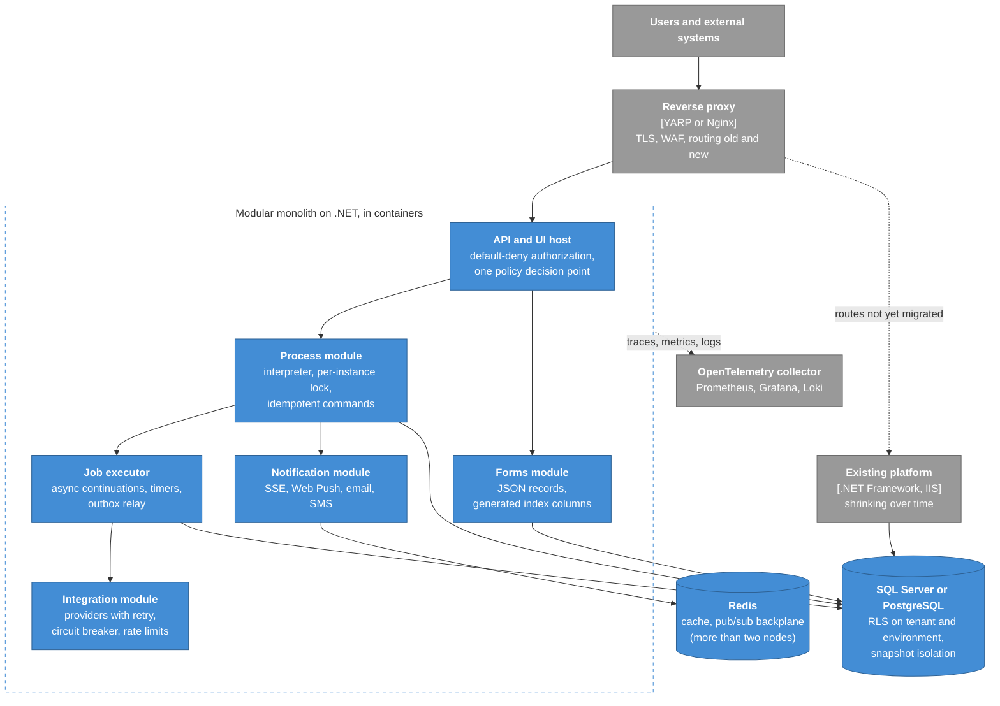

# 6. Retrospective: what I would keep and what I would change

[Home](../../README.md) · [Overview](01-overview.md) · [C4 model](02-c4-model.md) · [Process engine](03-process-engine.md) · [ADRs](adr/README.md) · [Load testing](04-load-testing.md) · [Security lessons](05-security-lessons.md) · **Retrospective** · [Glossary](glossary.md) · [Deutsch](../de/06-retrospective.md)

Most of the decisions in this repository were right for their time and their market: on-premises customers,
Microsoft-only IT departments, a small team and a national security evaluation. This page separates what I would
keep from what I would change, and sketches a migration path that does not need a rewrite.

## What I would keep

| Idea | Why it earned its place |
| --- | --- |
| One boring request path (controller → service → stored procedure) | Easy to secure, easy to explain to evaluators, easy to tune. |
| Immutable process versions with instance pinning | Publishing became a non-event, and the audit trail is exact. |
| Providers as the single integration abstraction | One connector serves forms, processes and reports. Hidden parameter sources removed a whole class of bugs. |
| Membership-based multi-organization tenancy | Fits groups and ministries. Cross-organization processes come for free. |
| Record-level sharing that business users manage themselves | Administrators stopped being the bottleneck. |
| Denormalized inbox read model | Flat latency on the hottest page. |
| A test sandbox inside production | Designers test against reality. |
| First-class Jalali calendar support, including timers | Non-negotiable for the market, and hard to retrofit. |
| SSE first, Web Push as fallback | Works through every proxy without client libraries. |

## What I would change

| Today | Target | Trigger to do it |
| --- | --- | --- |
| Engine walks synchronously inside the request; no lock per instance | Per-instance lock, idempotency keys, explicit asynchronous continuations through a job table and outbox ([ADR-0002](adr/0002-graph-walking-engine-inside-the-request.md)) | First customer with slow or unreliable external systems in service tasks |
| Engine depends on the web request context; timers loop back over HTTP | Engine as a plain service; timers as rows claimed by an in-process job executor ([ADR-0006](adr/0006-durable-clustered-timers.md)) | Together with the item above |
| Tenant and environment filters by convention | `SESSION_CONTEXT` plus Row-Level Security, fail closed ([ADR-0004](adr/0004-multi-organization-tenancy-in-one-database.md), [ADR-0011](adr/0011-test-sandbox-inside-the-production-engine.md)) | Now: it is cheap and it is a safety net |
| Dirty reads for monitoring and lists | `READ_COMMITTED_SNAPSHOT` at the database level | Now |
| Two permission evaluators | One policy decision point with table-driven tests ([ADR-0005](adr/0005-rbac-down-to-record-level.md)) | Next change to the permission model |
| About 1,000 stored procedures for everything | Procedures for set-based hot paths; plain parameterized SQL for CRUD; migrations with DbUp or Flyway in CI ([ADR-0001](adr/0001-stored-procedures-as-the-data-access-contract.md)) | New modules first; old ones when touched |
| Physical table per form, DDL at runtime | JSON column plus generated indexed columns, or DDL through a least-privileged schema service ([ADR-0007](adr/0007-dynamic-forms-as-physical-tables.md)) | A customer DBA refusing DDL rights for the application account |
| In-process session, caches and SSE registry | Stateless nodes: data-protection keys in the database, distributed cache and pub/sub backplane when there are more than two nodes | Scaling beyond two application nodes |
| .NET Framework 4.8 on Windows and IIS | .NET 8/10 on Linux containers, still on-premises | Every new service from now on |
| Logs in database tables | OpenTelemetry traces, metrics and logs; Prometheus, Grafana and Loki on site | The next major release |

## Target picture

## Migration path without a rewrite

Each step ships on its own and pays for itself.

1. **Safety nets first, with no schema change.** A per-instance application lock around engine commands. Idempotency
   keys on the process API. `READ_COMMITTED_SNAPSHOT` on the database. Tenant-isolation tests in CI.
2. **Row-Level Security** for the organization and the test environment, fed from `SESSION_CONTEXT`. Run it in
   audit mode first and log violations, then enforce.
3. **Asynchronous continuations.** A job table and an executor inside the existing application. Designers can mark
   service tasks "asynchronous". Timers move onto the same executor, and the HTTP loopback disappears.
4. **Engine without web request context.** Extract the engine behind an interface that the web layer, the executor
   and tests can call. This is the largest refactoring, and the previous steps make it safe.
5. **Strangler fig.** Put YARP in front. New modules and rewritten endpoints run on .NET 8/10 in containers. The
   proxy routes them, the old application keeps the rest, and both share the database during the transition.
6. **Observability.** OpenTelemetry in both old and new code, so that a request can be followed across the
   boundary.

## Build or buy, revisited

If I started today with a stack that allowed it, I would seriously consider **Camunda 8 or Flowable as the execution
core** and spend our own effort where customers feel it: forms, routing and delegation rules, the Persian calendar,
monitoring, the low-code designers and the integration catalog. Building an engine taught the team a great deal. But
a mature engine's handling of concurrency, incidents and migration is years of work that a product team rarely gets
paid for.
