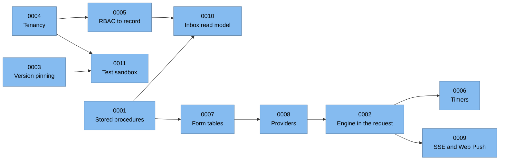

# Architecture decision records

[Home](../../../README.md) · [Overview](../01-overview.md) · [C4 model](../02-c4-model.md) · [Process engine](../03-process-engine.md) · **ADRs** · [Load testing](../04-load-testing.md) · [Security lessons](../05-security-lessons.md) · [Retrospective](../06-retrospective.md) · [Glossary](../glossary.md) · [Deutsch](../../de/adr/README.md)

I wrote these records **retrospectively**. Each one explains a decision that shapes the platform as it runs today.
For each decision it gives the forces behind it, the realistic alternatives, what it cost us, and what I would decide
now. The "options" sections list the alternatives a reasonable team would weigh. They are not minutes of a meeting.

The format is a light version of [MADR](https://adr.github.io/madr/). A blank copy is in [template.md](template.md).

| ADR | Decision | Status |
| --- | --- | --- |
| [0001](0001-stored-procedures-as-the-data-access-contract.md) | Stored procedures as the data-access contract | Accepted |
| [0002](0002-graph-walking-engine-inside-the-request.md) | An in-house BPMN interpreter that walks the graph inside the request | Accepted, with known limits |
| [0003](0003-pin-running-instances-to-their-version.md) | Pin running instances to the version they started on | Accepted |
| [0004](0004-multi-organization-tenancy-in-one-database.md) | Multi-organization tenancy in one shared database | Accepted |
| [0005](0005-rbac-down-to-record-level.md) | Role-based access control down to record level | Accepted |
| [0006](0006-durable-clustered-timers.md) | Durable, clustered timers with Jalali-aware schedules | Accepted, replaces an earlier job library |
| [0007](0007-dynamic-forms-as-physical-tables.md) | Each dynamic form owns a physical table | Accepted |
| [0008](0008-providers-as-the-single-integration-abstraction.md) | Providers as the single integration abstraction | Accepted |
| [0009](0009-server-sent-events-first-web-push-as-fallback.md) | Server-Sent Events first, Web Push as fallback | Accepted, replaces SignalR |
| [0010](0010-denormalized-inbox-read-model.md) | A denormalized inbox read model | Accepted |
| [0011](0011-test-sandbox-inside-the-production-engine.md) | A test sandbox inside the production engine | Accepted |

## How the decisions relate

ADR-0004 and ADR-0011 share a lesson: whenever a dimension such as tenant or environment has to be filtered in every
query, rely on a central mechanism to enforce it, not on each query remembering to.
